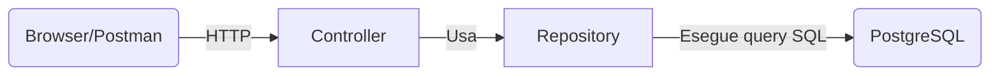
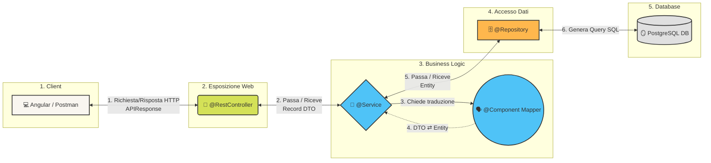
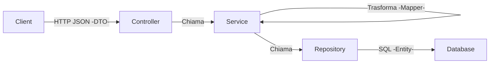
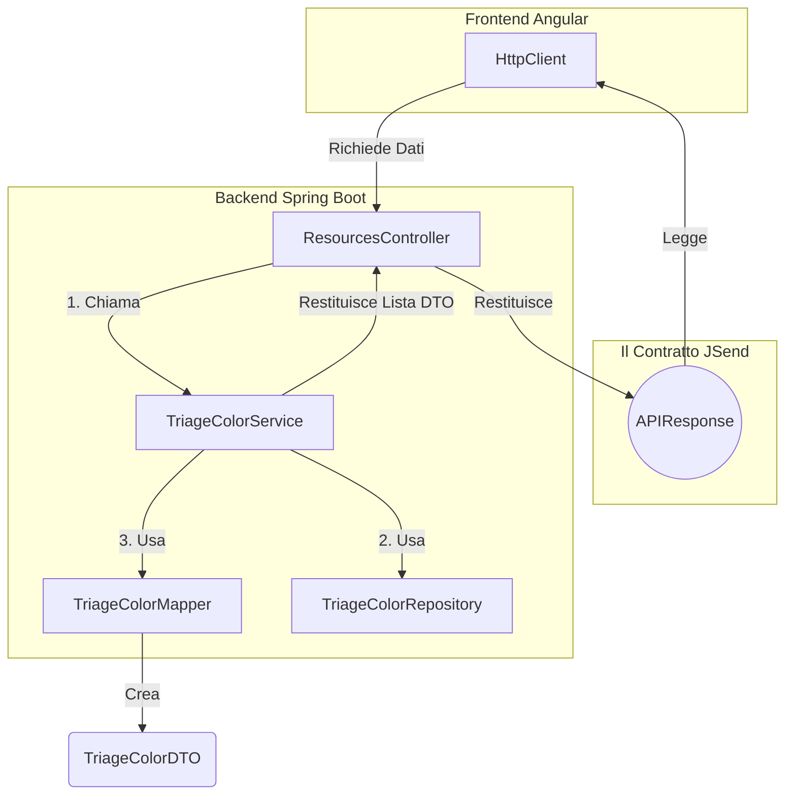

## Spring Boot Application Architecture

## Spring Boot Application Architecture with Service Layer

## Pattern JSend

## Componenti Springboot

Ecco il contenuto pronto per essere inserito nelle tue prossime due slide. Ho mantenuto un formato visivo molto chiaro e conciso, perfetto per essere proiettato in aula.

---

### Slide 1: Riassunto dell'Ecosistema Spring Boot 🧩

**Titolo:** I Mattoni Fondamentali (Chi fa cosa)

| Annotazione / Tipo | Ruolo Metaforico | Compito Principale |
| --- | --- | --- |
| **`@SpringBootApplication`** | 🚀 **Il Motore** | Punto d'ingresso. Avvia il server, carica le configurazioni e scansiona il codice. |
| **`@RestController`** | 👮 **Il Vigile Urbano** | Intercetta le richieste HTTP (GET, POST), smista il traffico al Service e restituisce il JSON. |
| **`@Service`** | 🧠 **Il Cervello** | Contiene la logica di business. Prende decisioni, coordina il Mapper e il Repository. |
| **`Record` (DTO)** | 💼 **La Valigetta** | Contenitore immutabile e sicuro. Fa viaggiare i dati "puliti" da e verso l'esterno. |
| **`@Component` (Mapper)** | 🗣️ **Il Traduttore** | Converte i dati dalla lingua del DB (Entity) a quella dell'utente (DTO) e viceversa. |
| **`@Repository`** | 🗄️ **L'Archivista** | Dialoga con il database. Genera ed esegue le query SQL in automatico (CRUD). |
| **`@Entity`** | 🪞 **Lo Specchio** | La rappresentazione Java (classe) di una specifica tabella del database relazionale. |

---

### Slide 2: Il Flusso dei Dati (Diagramma Architetturale) 🔄

**Titolo:** Il Viaggio di una Richiesta HTTP

*(Puoi inserire questo codice Mermaid direttamente nel tuo file Markdown o in un visualizzatore online come mermaid.live per incollare l'immagine nella slide).*

**Spiegazione da dare a voce durante questa slide:**

1. Il Client chiede un dato (es. Colori Triage).
2. Il **Controller** riceve la chiamata e, non sapendo come accedere al DB, passa la palla al **Service**.
3. Il **Service** chiede al **Repository** le **Entity**.
4. Ottenute le **Entity** dal DB, il **Service** le passa al **Mapper** chiedendo di tradurle in **DTO** (più sicuri e puliti).
5. Il **Service** ridà i **DTO** al **Controller**.
6. Il **Controller** li impacchetta in un' `APIResponse` e li spedisce ad Angular sotto forma di JSON.
7. 